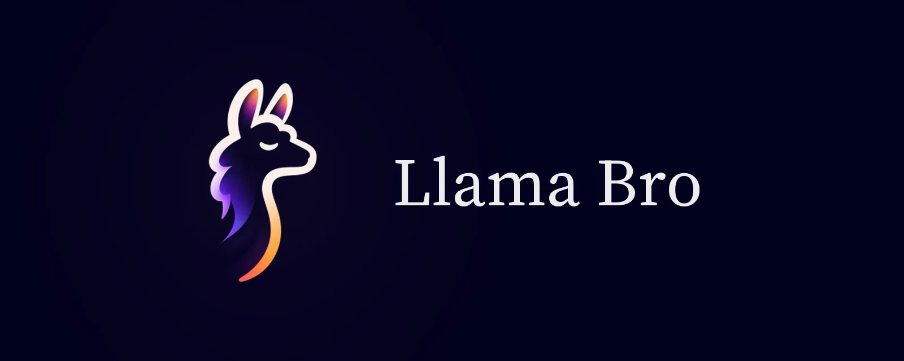
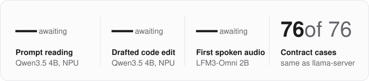
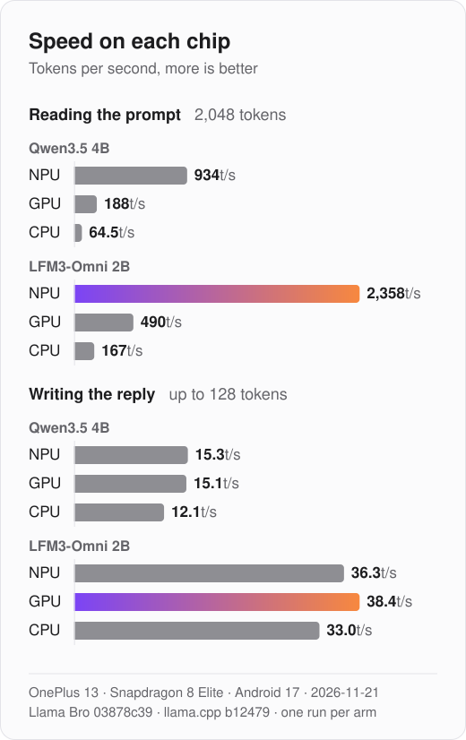
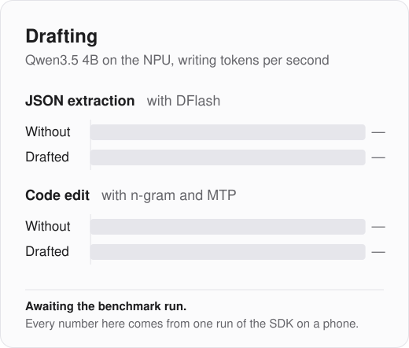
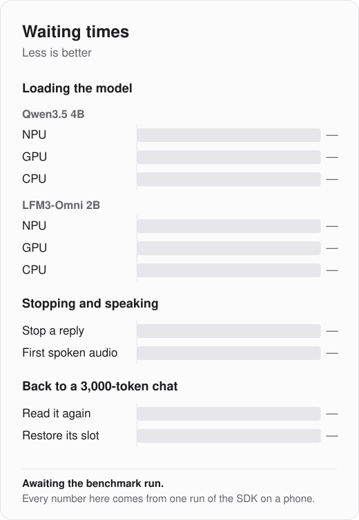

<p align="center">
  
</p>

<p align="center">
  <b>Run GGUF models on Android with llama.cpp's own <code>llama-server</code>,<br>inside your app's process, from Kotlin, with no HTTP and no port.</b>
</p>

<p align="center">
  <a href="LICENSE"></a>
  <a href="sdk/build-logic/src/main/kotlin/llamabro.library.gradle.kts"></a>
  <a href="sdk/llamabro/build.gradle.kts"></a>
  <a href="docs/decisions.md#d93-llamacpp-is-pinned-at-b12479-upstream-master-on-2026-11-17"></a>
</p>

<p align="center">
  <picture>
    <source media="(max-width: 600px) and (prefers-color-scheme: dark)" srcset="assets/readme/stats-narrow-dark.svg">
    <source media="(max-width: 600px)" srcset="assets/readme/stats-narrow-light.svg">
    <source media="(prefers-color-scheme: dark)" srcset="assets/readme/stats-dark.svg">
    
  </picture>
</p>

<p align="center">
  <picture>
    <source media="(prefers-color-scheme: dark)" srcset="assets/readme/demo-chat-dark.webp">
    
  </picture>
  <picture>
    <source media="(prefers-color-scheme: dark)" srcset="assets/readme/demo-voice-dark.webp">
    
  </picture>
  <br>
  <sub>The demo app in <a href="demo/"><code>demo/</code></a>, captured on an emulator over the SDK's fake engine with scripted replies.</sub>
</p>

## Why Llama Bro

**llama-server, in your process.** The SDK links llama-server's `server-context` library and calls its route handlers
directly ([architecture §3](docs/architecture.md#3-the-engine-llama-server-in-process),
[D12](docs/decisions.md#d12-inference-engine)). There is no localhost port that another app on the phone could reach,
no second process and no IPC ([§1.3](docs/architecture.md#13-in-process-one-runtime),
[D5](docs/decisions.md#d5-process-model)). Kotlin sees coroutines and `Flow`.

**Answers as llama-server answers.** Chat templates, tool calls, reasoning, the prompt cache, sampling, speculative
decoding, pictures and audio in, embeddings and rerank are upstream's code, not a reimplementation
([§3.3](docs/architecture.md#33-what-this-provides)). The SDK's contract check sends the same requests to the SDK and to
the `llama-server` binary built from the same tree and requires identical answers
([docs/testing.md](docs/testing.md#host-steps)). On the phone's NPU, 76 of 76 contract cases are identical
([F163](docs/research/findings.md#voice-mode-f163f173)). Where the SDK departs from upstream, a measurement says why
([§1.2](docs/architecture.md#12-the-baseline-is-upstream)).

**Picks the chip and fits the memory.** Add `llamabro-hexagon` or `llamabro-opencl` and a model loads on the NPU, else
the GPU, else the CPU, skipping any that fails; `loadReport` says where it runs and why the others were passed over
([§8.2](docs/architecture.md#82-selection-and-fallback), [D24](docs/decisions.md#d24-backend-discovery-and-device-choice)).
`ContextSize.Auto` picks the largest context up to 16,384 tokens that fits the memory the phone has free, measured by
llama.cpp's own dry run ([§9](docs/architecture.md#9-memory-fit-and-contextsizeauto),
[D33](docs/decisions.md#d33-contextsizeauto-fits-all-memory)).

## Quick start

The SDK is not published yet. Its coordinates will be `io.github.whyisitworking:llamabro`; until then, include the
`sdk` build from a whole clone of this repository (it reads the clone's version catalog; building the app needs the
submodule and the toolchain under [Build](#build)), and Gradle substitutes it for the coordinates:

```kotlin
// settings.gradle.kts
includeBuild("path/to/Llama-Bro/sdk")

// app/build.gradle.kts
implementation("io.github.whyisitworking:llamabro")
```

arm64-v8a, Android 10 (API 29) and up, Kotlin 2.2 or later
([D82](docs/decisions.md#d82-the-sdk-compiles-with-the-catalogs-kotlin-apps-need-kotlin-22-or-later)). What changed in
the unreleased version is in [docs/release-notes.md](docs/release-notes.md).

```kotlin
val llama = LlamaBro.create(application)
val model = llama.loadModel(ModelSource.file(path))
val chat = model.conversation(system = "You are a helpful assistant.")
chat.send("Hello").collect()          // observe chat.messages and chat.reply
model.close()
```

By its Hugging Face name, with a typed reply (`llamabro-hub`, `llamabro-typed`):

```kotlin
val hub = LlamaBroHub.create(application)
val model = llama.loadModel(hub.model("unsloth/Qwen3.5-4B-GGUF:Q4_K_M"))   // downloads once, then loads offline

@Serializable data class Review(val stars: Int, val summary: String)
val review = model.generate<Review>("The battery lasts two days, but the screen scratches.").valueOrNull()
```

[sdk/README.md](sdk/README.md) has a full chat screen, tools, voice, embeddings, the Hub, backends and error handling.

## Benchmarks

Every number here is the SDK itself, measured through its public API on one phone, a OnePlus 13 (Snapdragon 8 Elite,
the phone the SDK is verified on, [D92](docs/decisions.md#d92-auto-keeps-trying-the-npu-and-the-gpu-on-every-qualcomm-chip-only-one-phone-is-verified)):

- **Reading a prompt** of 2,048 tokens, Qwen3.5 4B on the NPU: <!-- bench:qwen-npu.promptTps -->—<!-- /bench --> tokens
  per second.
- **Writing a code edit**, Qwen3.5 4B on the NPU: <!-- bench:edit-ngram-mtp.predictedTps -->—<!-- /bench --> tokens
  per second with n-gram drafting and MTP behind it, against <!-- bench:edit-off.predictedTps -->—<!-- /bench --> without
  drafting.
- **Speaking back** with LFM3-Omni 2B on the NPU: the first audio comes <!-- bench:voice.extra.firstAudioMs/1000 -->—<!-- /bench -->
  s after the app commits the user's spoken turn.
- **Stopping a reply**: every slot is idle <!-- bench:stop.extra.stopMs -->—<!-- /bench --> ms after the cancel.
- **Coming back to a chat of about 3,000 tokens** after the model was freed, from loading the model to the answer to
  the next message: <!-- bench:restore.extra.restoreMs/1000 -->—<!-- /bench --> s when its saved slot is restored, against the
  chat read again in <!-- bench:restore.extra.readAgainMs/1000 -->—<!-- /bench --> s.

<p align="center">
  <picture>
    <source media="(prefers-color-scheme: dark)" srcset="assets/readme/speed-dark.svg">
    
  </picture>
</p>

<p align="center">
  <picture>
    <source media="(prefers-color-scheme: dark)" srcset="assets/readme/drafting-dark.svg">
    
  </picture>
</p>

<p align="center">
  <picture>
    <source media="(prefers-color-scheme: dark)" srcset="assets/readme/latency-dark.svg">
    
  </picture>
</p>

<details>
<summary>Every number as a table</summary>

Reading a 2,048-token prompt and writing a reply of up to 128 tokens, in tokens per second; loading, in seconds.

| Model | Chip | Reading | Writing | Loading |
|---|---|--:|--:|--:|
| Qwen3.5 4B | NPU | <!-- bench:qwen-npu.promptTps -->—<!-- /bench --> | <!-- bench:qwen-npu.predictedTps -->—<!-- /bench --> | <!-- bench:qwen-npu.loadMs/1000 -->—<!-- /bench --> |
| Qwen3.5 4B | GPU | <!-- bench:qwen-gpu.promptTps -->—<!-- /bench --> | <!-- bench:qwen-gpu.predictedTps -->—<!-- /bench --> | <!-- bench:qwen-gpu.loadMs/1000 -->—<!-- /bench --> |
| Qwen3.5 4B | CPU | <!-- bench:qwen-cpu.promptTps -->—<!-- /bench --> | <!-- bench:qwen-cpu.predictedTps -->—<!-- /bench --> | <!-- bench:qwen-cpu.loadMs/1000 -->—<!-- /bench --> |
| LFM3-Omni 2B | NPU | <!-- bench:lfm-npu.promptTps -->—<!-- /bench --> | <!-- bench:lfm-npu.predictedTps -->—<!-- /bench --> | <!-- bench:lfm-npu.loadMs/1000 -->—<!-- /bench --> |
| LFM3-Omni 2B | GPU | <!-- bench:lfm-gpu.promptTps -->—<!-- /bench --> | <!-- bench:lfm-gpu.predictedTps -->—<!-- /bench --> | <!-- bench:lfm-gpu.loadMs/1000 -->—<!-- /bench --> |
| LFM3-Omni 2B | CPU | <!-- bench:lfm-cpu.promptTps -->—<!-- /bench --> | <!-- bench:lfm-cpu.predictedTps -->—<!-- /bench --> | <!-- bench:lfm-cpu.loadMs/1000 -->—<!-- /bench --> |

Drafting, Qwen3.5 4B on the NPU, writing at most 256 tokens, in tokens per second.

| Request | Drafting off | Drafting on |
|---|--:|--:|
| JSON extraction, with a DFlash draft model | <!-- bench:json-off.predictedTps -->—<!-- /bench --> | <!-- bench:json-dflash.predictedTps -->—<!-- /bench --> |
| Code edit, with n-gram drafting and MTP | <!-- bench:edit-off.predictedTps -->—<!-- /bench --> | <!-- bench:edit-ngram-mtp.predictedTps -->—<!-- /bench --> |

Waiting times.

| Moment | Time |
|---|--:|
| Stopping a reply: the cancel until every slot is idle | <!-- bench:stop.extra.stopMs -->—<!-- /bench --> ms |
| Stopping a reply: the cancel call's return, the app's side | <!-- bench:stop.extra.cancelReturnMs -->—<!-- /bench --> ms |
| Voice, LFM3-Omni 2B: the app's commit of the user's turn until the first reply audio | <!-- bench:voice.extra.firstAudioMs/1000 -->—<!-- /bench --> s |
| Voice, LFM3-Omni 2B: seconds of reply audio per second from the commit to the end of the reply | <!-- bench:voice.extra.realtimeFactor -->—<!-- /bench --> |
| A 3,000-token chat after the model was freed, from loading to the next answer: read again | <!-- bench:restore.extra.readAgainMs/1000 -->—<!-- /bench --> s |
| The same, with its saved slot restored before the question | <!-- bench:restore.extra.restoreMs/1000 -->—<!-- /bench --> s |

</details>

### How they were measured

- Every arm runs in a fresh process with a fresh load. The speed, drafting and stop arms
  ([`BenchDeviceTest`](sdk/acceptance/backends/src/androidTest/kotlin/com/suhel/llamabro/sample/BenchDeviceTest.kt)) use one chip, a context of 8,192 tokens, no prompt cache, thinking off and greedy
  sampling; their speeds are llama-server's own timings of the request. The voice arm, in the same test, is a realtime
  session set up with a voice, a language and an instruction, fed a recorded question at microphone pace. The restore
  arm ([`SlotCacheDeviceTest`](sdk/acceptance/backends/src/androidTest/kotlin/com/suhel/llamabro/sample/SlotCacheDeviceTest.kt)) lets the SDK choose the chip. The code-edit figure covers the
  reply's first 256 tokens, the start of the edited file, which are almost all copied from the prompt: where n-gram
  drafting gains most. Each arm's request is in the [method's table](research/bench/README.md#what-each-arm-asks).
- Models are Q4_K_M; the DFlash draft and LFM3-Omni's projector are Q8_0. Each arm runs three rounds by default, in
  reversed order every second round, and before each arm the script waits for the phone's thermal status to be 1 or
  lower. A figure is the median of the rounds; the range is kept beside it.
- [`sdk/scripts/bench.sh`](sdk/scripts/bench.sh) runs it,
  [`sdk/scripts/bench.py`](sdk/scripts/bench.py) draws the charts and checks every figure on this page against the
  results. The method, the requests and what the numbers do not cover are in
  [research/bench/README.md](research/bench/README.md).

## Known issues

- Llama 3.2 3B repeats a tool call until the turn limit, as it does on upstream
  ([F27](docs/research/findings.md#f27-p1-device-acceptance-qwen35-passes-everything-gemma-3-has-no-tools-llama-32-3b-loops-on-tool-calls)).
- Speculative decoding aborts the OpenCL GPU backend, so the SDK never drafts on the GPU
  ([F80](docs/research/findings.md#f80-any-drafting-aborts-the-gpu-backend-f75s-switch-on-or-not-the-p2-reviews-findings-and-what-changed)).
- Vulkan runs on the Adreno 830 only with patches and is slower there than the CPU and OpenCL, so it is not built
  ([F174](docs/research/findings.md#vulkan-on-the-adreno-830-retried-f174)).

## What's inside

| Module | What it does |
|---|---|
| `llamabro` | The core: load a model, chat, `Conversation` with the tool loop and compaction, embeddings, rerank, transcription, a realtime voice session, and every llama-server route as raw JSON |
| `llamabro-hub` | Hugging Face search, and downloads that resume and are checked against the published SHA-256 ([D40](docs/decisions.md#d40-every-download-is-hashed)); a model loads by name and offline once on the phone ([D64](docs/decisions.md#d64-one-call-from-a-hugging-face-name-to-a-loaded-model-through-an-open-modelsource-what-is-on-the-phone-loads-without-the-network)) |
| `llamabro-hub-work` | A WorkManager download that outlives the app's process |
| `llamabro-typed`, `llamabro-typed-ksp` | Replies and tools typed by `@Serializable` classes, held to their JSON schema by llama.cpp's grammar; annotated toolboxes checked when the app builds ([D63](docs/decisions.md#d63-typed-output-and-typed-tools-share-one-module-llamabro-typed-a-typed-reply-is-a-typedt)) |
| `llamabro-hexagon`, `llamabro-opencl` | The Hexagon NPU and Adreno GPU backends, optional |
| `llamabro-testing`, `llamabro-hub-testing` | `FakeLlamaBro` and `FakeLlamaBroHub`: the real API over a scripted engine and Hub, for your JVM tests |

The [demo chat app](demo/README.md) is built on the SDK: it finds, downloads and runs models, with pictures, voice
notes, a voice mode with captions, thinking levels and two layouts.

| Folder | What it is |
|---|---|
| [`sdk/`](sdk/README.md) | The SDK modules, `acceptance/` (device test apps), `native/` (the C++ bridge, patches and the llama.cpp submodule), `scripts/` (the checks) |
| [`demo/`](demo/README.md) | The demo app and its design system on Material 3 |
| [`docs/`](docs/README.md) | Architecture, decisions, testing, the demo's design, and the research record |
| [`research/`](research/README.md) | The experiments behind the design: scripts, method and results |
| `gradle/` | The Gradle wrapper and the shared version catalog |

## Build

Open the repository root in Android Studio. It is one Gradle build over the SDK modules and the demo app; run
`:demo:app`. You need the Android SDK, NDK 29 and CMake 4.1.2, and the llama.cpp submodule:

```bash
git submodule update --init sdk/native/third_party/llama.cpp
```

The root build and `./gradlew -p sdk ...` (the SDK alone) share `build/` folders; do not run both at once.

## Verify

```bash
sdk/scripts/check.sh              # the SDK on the host; must print ALL PASS
sdk/scripts/check.sh --device     # plus tests on an attached device
demo/scripts/check.sh             # the demo app (add --device for the instrumented tests and journeys)
```

What each check proves, and what it needs, is in [docs/testing.md](docs/testing.md).

## Documentation

| Document | What it holds |
|---|---|
| [docs/architecture.md](docs/architecture.md) | How the SDK is built: the engine, the C API, the Kotlin API, memory, backends, the Hub |
| [docs/decisions.md](docs/decisions.md) | Every design decision (`D<n>`), and the findings behind it |
| [docs/research/findings.md](docs/research/findings.md) | Every measurement and upstream reading (`F<n>`), with its evidence |
| [docs/release-notes.md](docs/release-notes.md) | What changed for apps |
| [docs/README.md](docs/README.md) | The full index |

## Contributing

See [CONTRIBUTING.md](CONTRIBUTING.md). Design questions start in [docs/architecture.md](docs/architecture.md) and
[docs/decisions.md](docs/decisions.md); measured behaviour is in [docs/research/findings.md](docs/research/findings.md).

## License

Apache License 2.0, see [LICENSE](LICENSE). Built on [llama.cpp](https://github.com/ggml-org/llama.cpp) (MIT). The
demo bundles Geist and Source Serif 4 under the SIL Open Font License (`demo/designsystem/src/main/res/raw/geist_ofl.txt`,
`demo/designsystem/src/main/res/raw/source_serif_4_ofl.txt`).
