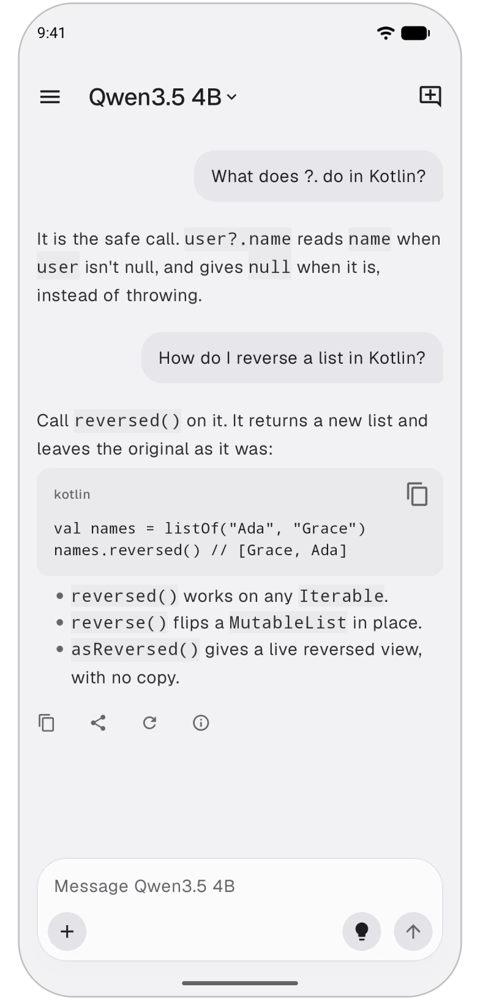
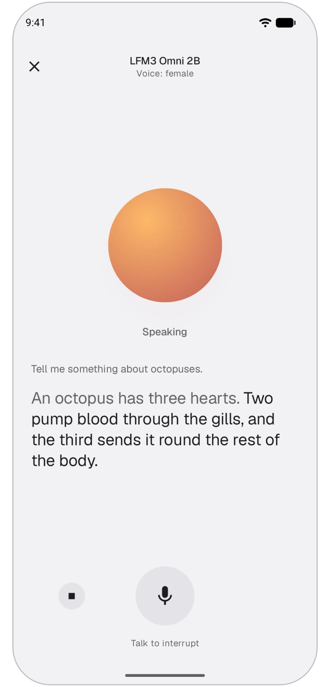

<p align="center">
  
</p>

<p align="center">
  <b>Run GGUF models on Android with llama.cpp's own <code>llama-server</code>,<br>inside your app's process, from Kotlin, with no HTTP and no port.</b>
</p>

<p align="center">
  <a href="https://central.sonatype.com/namespace/io.github.whyisitworking"></a>
  <a href="LICENSE"></a>
  <a href="sdk/build-logic/src/main/kotlin/llamabro.library.gradle.kts"></a>
  <a href="sdk/llamabro/build.gradle.kts"></a>
  <a href="docs/decisions.md#d137-llamacpp-is-pinned-at-b12653-upstream-master-on-2026-11-23"></a>
</p>

<p align="center">
  <a href="#the-numbers">The numbers</a> ·
  <a href="#why-llama-bro">Why Llama Bro</a> ·
  <a href="#get-started">Get started</a> ·
  <a href="#modules">Modules</a> ·
  <a href="#the-demo-app">The demo app</a> ·
  <a href="#documentation">Docs</a>
</p>

<p align="center">
  <picture>
    <source media="(max-width: 600px) and (prefers-color-scheme: dark)" srcset="assets/readme/stats-narrow-dark.svg">
    <source media="(max-width: 600px)" srcset="assets/readme/stats-narrow-light.svg">
    <source media="(prefers-color-scheme: dark)" srcset="assets/readme/stats-dark.svg">
    
  </picture>
</p>

<p align="center">
  <picture>
    <source media="(prefers-color-scheme: dark)" srcset="assets/readme/demo-chat-dark.webp">
    
  </picture>
  <picture>
    <source media="(prefers-color-scheme: dark)" srcset="assets/readme/demo-voice-dark.webp">
    
  </picture>
  <br>
  <a href="https://github.com/whyisitworking/llama-bro/releases/latest/download/llama-bro-demo.apk"></a>
  <br>
  <sub>The <a href="demo/README.md">demo app</a>, shown over the SDK's fake engine. The APK is the latest release's, for arm64 phones on Android 10 and up.</sub>
</p>

## The numbers

One run of 37 benchmarks on a OnePlus 13 (Snapdragon 8 Elite), every one through the SDK's public API, none failed.
A script checks each figure on this page against the run's results
([F178](docs/research/findings.md#f178-the-readmes-benchmark-run-37-arms-on-the-oneplus-13)).

- ⚡ **<!-- bench:ladder-lfm230m-npu.promptTps -->7,299<!-- /bench --> tokens a second** reading a prompt with LFM2.5 230M on the NPU; Qwen3.5 4B reads a
  2,048-token document at **<!-- bench:qwen-npu.promptTps -->934<!-- /bench -->**, more than 14× its CPU speed.
- 🧠 **Six models from 230M to 4B run on all three chips**, the NPU fastest for each: from
  <!-- bench:ladder-lfm230m-npu.predictedTps -->171<!-- /bench --> tokens a second written (LFM2.5 230M) to <!-- bench:ladder-qwen4b-npu.predictedTps -->15.3<!-- /bench --> (Qwen3.5 4B).
- ✍️ **<!-- bench:edit-ngram-mtp.predictedTps -->120<!-- /bench --> tokens a second** writing a code edit with n-gram drafting and MTP, 8× the
  <!-- bench:edit-off.predictedTps -->14.9<!-- /bench --> without.
- 🗣️ **<!-- bench:voice.extra.firstAudioMs/1000 -->0.38<!-- /bench --> s to the first spoken audio** in a realtime voice session with LFM3-Omni 2B, which speaks
  <!-- bench:voice.extra.realtimeFactor -->1.4<!-- /bench -->× faster than real time.
- 🔎 **<!-- bench:rerank-npu.extra.itemsPerSecond -->227<!-- /bench --> sentences a second reranked**, <!-- bench:embed-npu.extra.itemsPerSecond -->108<!-- /bench --> embedded, on the NPU.
- 🛑 **<!-- bench:stop.extra.stopMs -->85<!-- /bench --> ms** from cancel to an idle engine; a 3,000-token chat back in **<!-- bench:restore.extra.restoreMs/1000 -->5.1<!-- /bench --> s** from its saved
  slot, against <!-- bench:restore.extra.readAgainMs/1000 -->8.3<!-- /bench --> s read again.

<p align="center">
  <picture>
    <source media="(max-width: 600px) and (prefers-color-scheme: dark)" srcset="assets/readme/board-narrow-dark.svg">
    <source media="(max-width: 600px)" srcset="assets/readme/board-narrow-light.svg">
    <source media="(prefers-color-scheme: dark)" srcset="assets/readme/board-dark.svg">
    
  </picture>
</p>

<details>
<summary>Every number as a table</summary>

Reading a 2,048-token prompt and writing a reply of up to 128 tokens, in tokens per second; loading, in seconds.

| Model | Chip | Reading | Writing | Loading |
|---|---|--:|--:|--:|
| Qwen3.5 4B | NPU | <!-- bench:qwen-npu.promptTps -->934<!-- /bench --> | <!-- bench:qwen-npu.predictedTps -->15.3<!-- /bench --> | <!-- bench:qwen-npu.loadMs/1000 -->5.2<!-- /bench --> |
| Qwen3.5 4B | GPU | <!-- bench:qwen-gpu.promptTps -->188<!-- /bench --> | <!-- bench:qwen-gpu.predictedTps -->15.1<!-- /bench --> | <!-- bench:qwen-gpu.loadMs/1000 -->40.3<!-- /bench --> |
| Qwen3.5 4B | CPU | <!-- bench:qwen-cpu.promptTps -->64.5<!-- /bench --> | <!-- bench:qwen-cpu.predictedTps -->12.1<!-- /bench --> | <!-- bench:qwen-cpu.loadMs/1000 -->7.9<!-- /bench --> |
| LFM3-Omni 2B | NPU | <!-- bench:lfm-npu.promptTps -->2,358<!-- /bench --> | <!-- bench:lfm-npu.predictedTps -->36.3<!-- /bench --> | <!-- bench:lfm-npu.loadMs/1000 -->2.2<!-- /bench --> |
| LFM3-Omni 2B | GPU | <!-- bench:lfm-gpu.promptTps -->490<!-- /bench --> | <!-- bench:lfm-gpu.predictedTps -->38.4<!-- /bench --> | <!-- bench:lfm-gpu.loadMs/1000 -->9.6<!-- /bench --> |
| LFM3-Omni 2B | CPU | <!-- bench:lfm-cpu.promptTps -->167<!-- /bench --> | <!-- bench:lfm-cpu.predictedTps -->33.0<!-- /bench --> | <!-- bench:lfm-cpu.loadMs/1000 -->2.8<!-- /bench --> |

The model ladder: a 512-token prompt and a reply of up to 64 tokens, in tokens per second; loading, in seconds.

| Model | Chip | Reading | Writing | Loading |
|---|---|--:|--:|--:|
| LFM2.5 230M | NPU | <!-- bench:ladder-lfm230m-npu.promptTps -->7,299<!-- /bench --> | <!-- bench:ladder-lfm230m-npu.predictedTps -->171<!-- /bench --> | <!-- bench:ladder-lfm230m-npu.loadMs/1000 -->0.58<!-- /bench --> |
| LFM2.5 230M | GPU | <!-- bench:ladder-lfm230m-gpu.promptTps -->2,243<!-- /bench --> | <!-- bench:ladder-lfm230m-gpu.predictedTps -->136<!-- /bench --> | <!-- bench:ladder-lfm230m-gpu.loadMs/1000 -->4.9<!-- /bench --> |
| LFM2.5 230M | CPU | <!-- bench:ladder-lfm230m-cpu.promptTps -->168<!-- /bench --> | <!-- bench:ladder-lfm230m-cpu.predictedTps -->149<!-- /bench --> | <!-- bench:ladder-lfm230m-cpu.loadMs/1000 -->0.80<!-- /bench --> |
| Qwen3.5 0.8B | NPU | <!-- bench:ladder-qwen08b-npu.promptTps -->2,174<!-- /bench --> | <!-- bench:ladder-qwen08b-npu.predictedTps -->53.4<!-- /bench --> | <!-- bench:ladder-qwen08b-npu.loadMs/1000 -->1.7<!-- /bench --> |
| Qwen3.5 0.8B | GPU | <!-- bench:ladder-qwen08b-gpu.promptTps -->531<!-- /bench --> | <!-- bench:ladder-qwen08b-gpu.predictedTps -->48.6<!-- /bench --> | <!-- bench:ladder-qwen08b-gpu.loadMs/1000 -->8.5<!-- /bench --> |
| Qwen3.5 0.8B | CPU | <!-- bench:ladder-qwen08b-cpu.promptTps -->259<!-- /bench --> | <!-- bench:ladder-qwen08b-cpu.predictedTps -->46.8<!-- /bench --> | <!-- bench:ladder-qwen08b-cpu.loadMs/1000 -->6.7<!-- /bench --> |
| LFM3 1.7B | NPU | <!-- bench:ladder-lfm17b-npu.promptTps -->1,682<!-- /bench --> | <!-- bench:ladder-lfm17b-npu.predictedTps -->34.1<!-- /bench --> | <!-- bench:ladder-lfm17b-npu.loadMs/1000 -->2.1<!-- /bench --> |
| LFM3 1.7B | GPU | <!-- bench:ladder-lfm17b-gpu.promptTps -->348<!-- /bench --> | <!-- bench:ladder-lfm17b-gpu.predictedTps -->33.5<!-- /bench --> | <!-- bench:ladder-lfm17b-gpu.loadMs/1000 -->11.9<!-- /bench --> |
| LFM3 1.7B | CPU | <!-- bench:ladder-lfm17b-cpu.promptTps -->143<!-- /bench --> | <!-- bench:ladder-lfm17b-cpu.predictedTps -->32.6<!-- /bench --> | <!-- bench:ladder-lfm17b-cpu.loadMs/1000 -->3.2<!-- /bench --> |
| Llama 3.2 3B | NPU | <!-- bench:ladder-llama3b-npu.promptTps -->1,392<!-- /bench --> | <!-- bench:ladder-llama3b-npu.predictedTps -->21.2<!-- /bench --> | <!-- bench:ladder-llama3b-npu.loadMs/1000 -->4.0<!-- /bench --> |
| Llama 3.2 3B | GPU | <!-- bench:ladder-llama3b-gpu.promptTps -->202<!-- /bench --> | <!-- bench:ladder-llama3b-gpu.predictedTps -->17.0<!-- /bench --> | <!-- bench:ladder-llama3b-gpu.loadMs/1000 -->16.4<!-- /bench --> |
| Llama 3.2 3B | CPU | <!-- bench:ladder-llama3b-cpu.promptTps -->69.2<!-- /bench --> | <!-- bench:ladder-llama3b-cpu.predictedTps -->6.3<!-- /bench --> | <!-- bench:ladder-llama3b-cpu.loadMs/1000 -->12.2<!-- /bench --> |
| Gemma 3 4B (QAT) | NPU | <!-- bench:ladder-gemma4b-npu.promptTps -->172<!-- /bench --> | <!-- bench:ladder-gemma4b-npu.predictedTps -->14.2<!-- /bench --> | <!-- bench:ladder-gemma4b-npu.loadMs/1000 -->5.1<!-- /bench --> |
| Gemma 3 4B (QAT) | GPU | <!-- bench:ladder-gemma4b-gpu.promptTps -->152<!-- /bench --> | <!-- bench:ladder-gemma4b-gpu.predictedTps -->12.5<!-- /bench --> | <!-- bench:ladder-gemma4b-gpu.loadMs/1000 -->19.0<!-- /bench --> |
| Gemma 3 4B (QAT) | CPU | <!-- bench:ladder-gemma4b-cpu.promptTps -->48.6<!-- /bench --> | <!-- bench:ladder-gemma4b-cpu.predictedTps -->7.9<!-- /bench --> | <!-- bench:ladder-gemma4b-cpu.loadMs/1000 -->9.8<!-- /bench --> |
| Qwen3.5 4B | NPU | <!-- bench:ladder-qwen4b-npu.promptTps -->646<!-- /bench --> | <!-- bench:ladder-qwen4b-npu.predictedTps -->15.3<!-- /bench --> | <!-- bench:ladder-qwen4b-npu.loadMs/1000 -->5.4<!-- /bench --> |
| Qwen3.5 4B | GPU | <!-- bench:ladder-qwen4b-gpu.promptTps -->126<!-- /bench --> | <!-- bench:ladder-qwen4b-gpu.predictedTps -->14.1<!-- /bench --> | <!-- bench:ladder-qwen4b-gpu.loadMs/1000 -->19.9<!-- /bench --> |
| Qwen3.5 4B | CPU | <!-- bench:ladder-qwen4b-cpu.promptTps -->45.0<!-- /bench --> | <!-- bench:ladder-qwen4b-cpu.predictedTps -->11.5<!-- /bench --> | <!-- bench:ladder-qwen4b-cpu.loadMs/1000 -->9.9<!-- /bench --> |

Search models: 32 sentences in one request, after one request to warm up, in sentences per second.

| Model | NPU | GPU | CPU |
|---|--:|--:|--:|
| bge-small (embeddings) | <!-- bench:embed-npu.extra.itemsPerSecond -->108<!-- /bench --> | <!-- bench:embed-gpu.extra.itemsPerSecond -->46.2<!-- /bench --> | <!-- bench:embed-cpu.extra.itemsPerSecond -->41.6<!-- /bench --> |
| jina-reranker-tiny (rerank) | <!-- bench:rerank-npu.extra.itemsPerSecond -->227<!-- /bench --> | <!-- bench:rerank-gpu.extra.itemsPerSecond -->106<!-- /bench --> | <!-- bench:rerank-cpu.extra.itemsPerSecond -->69.4<!-- /bench --> |

Drafting, Qwen3.5 4B on the NPU, writing at most 256 tokens, in tokens per second.

| Request | Drafting off | Drafting on |
|---|--:|--:|
| JSON extraction, with a DFlash draft model | <!-- bench:json-off.predictedTps -->15.4<!-- /bench --> | <!-- bench:json-dflash.predictedTps -->14.0<!-- /bench --> |
| Code edit, with n-gram drafting and MTP | <!-- bench:edit-off.predictedTps -->14.9<!-- /bench --> | <!-- bench:edit-ngram-mtp.predictedTps -->120<!-- /bench --> |

Waiting times.

| Moment | Time |
|---|--:|
| Stopping a reply: the cancel until every slot is idle | <!-- bench:stop.extra.stopMs -->85<!-- /bench --> ms |
| Stopping a reply: the cancel call's return, the app's side | <!-- bench:stop.extra.cancelReturnMs -->3<!-- /bench --> ms |
| Voice, LFM3-Omni 2B: the app's commit of the user's turn until the first reply audio | <!-- bench:voice.extra.firstAudioMs/1000 -->0.38<!-- /bench --> s |
| Voice, LFM3-Omni 2B: seconds of reply audio per second from the commit to the end of the reply | <!-- bench:voice.extra.realtimeFactor -->1.4<!-- /bench --> |
| A 3,000-token chat after the model was freed, from loading to the next answer: read again | <!-- bench:restore.extra.readAgainMs/1000 -->8.3<!-- /bench --> s |
| The same, with its saved slot restored before the question | <!-- bench:restore.extra.restoreMs/1000 -->5.1<!-- /bench --> s |

</details>

<details>
<summary>How they were measured</summary>

- Each benchmark is a fresh process and a fresh load on one chip: context 8,192 tokens, no prompt cache, thinking off,
  greedy sampling, and llama-server's own timings
  ([`BenchDeviceTest`](sdk/acceptance/backends/src/androidTest/kotlin/com/suhel/llamabro/sample/BenchDeviceTest.kt)).
  The voice benchmark feeds a recorded question at microphone pace; the restore benchmark
  ([`SlotCacheDeviceTest`](sdk/acceptance/backends/src/androidTest/kotlin/com/suhel/llamabro/sample/SlotCacheDeviceTest.kt))
  lets the SDK pick the chip. The code edit's reply is mostly copied from its prompt, where n-gram drafting gains most.
- Q4_K_M models, except Gemma 3 4B (Unsloth's UD-Q4_K_XL of Google's QAT release) and the F16 search models; the
  DFlash draft and LFM3-Omni's projector are Q8_0. Each ran once, on a phone at thermal status 1 or lower.
- [`bench.sh`](sdk/scripts/bench.sh) runs it and [`bench.py`](sdk/scripts/bench.py) draws the charts; the requests
  and what the numbers do not cover are in [research/bench](research/bench/README.md#what-each-arm-asks).

</details>

## Why Llama Bro

**llama-server, in your process.** The SDK links llama-server's `server-context` library and calls its route handlers
directly ([architecture §3](docs/architecture.md#3-the-engine-llama-server-in-process),
[D12](docs/decisions.md#d12-inference-engine)). There is no localhost port that another app on the phone could reach,
no second process and no IPC ([§1.3](docs/architecture.md#13-in-process-one-runtime),
[D5](docs/decisions.md#d5-process-model)). Kotlin sees coroutines and `Flow`.

**Answers as llama-server answers.** Chat templates, tool calls, reasoning, the prompt cache, sampling, speculative
decoding, pictures and audio in, embeddings and rerank are upstream's code, not a reimplementation
([§3.3](docs/architecture.md#33-what-this-provides)). The SDK's contract check sends the same requests to the SDK and to
the `llama-server` binary built from the same tree and requires identical answers
([docs/testing.md](docs/testing.md#host-steps)). On the phone's NPU, 76 of 76 contract cases are identical
([F163](docs/research/findings.md#voice-mode-f163f173)). Where the SDK departs from upstream, a measurement says why
([§1.2](docs/architecture.md#12-the-baseline-is-upstream)).

**Picks the chip and fits the memory.** Add `llamabro-hexagon` or `llamabro-opencl` and a model loads on the NPU, else
the GPU, else the CPU, skipping any that fails; `loadReport` says where it runs and why the others were passed over
([§8.2](docs/architecture.md#82-selection-and-fallback), [D24](docs/decisions.md#d24-backend-discovery-and-device-choice)).
`ContextSize.Auto` picks the largest context up to 16,384 tokens that fits the memory the phone has free, measured by
llama.cpp's own dry run ([§9](docs/architecture.md#9-memory-fit-and-contextsizeauto),
[D33](docs/decisions.md#d33-contextsizeauto-fits-all-memory)).

## Get started

Android 10 (API 29) and up, arm64-v8a, Kotlin 2.2 or later
([D82](docs/decisions.md#d82-the-sdk-compiles-with-the-catalogs-kotlin-apps-need-kotlin-22-or-later)).
What changed in each version is in the [release notes](docs/release-notes.md).

### 1. Add the SDK

Import the BOM once, then list the modules you use without a version. The BOM adds no code: it keeps every Llama Bro
module at the same version, which the backends need, since they load native libraries built with the core's.

```kotlin
// app/build.gradle.kts
dependencies {
    // the BOM: one version for every Llama Bro module
    implementation(platform("io.github.whyisitworking:llamabro-bom:2.0.0-alpha"))

    // the modules, without versions
    implementation("io.github.whyisitworking:llamabro")           // the engine, always
    implementation("io.github.whyisitworking:llamabro-hexagon")   // optional: the Snapdragon NPU
    implementation("io.github.whyisitworking:llamabro-opencl")    // optional: the Adreno GPU
}
```

<details>
<summary>Without the BOM</summary>

Give every module the same version:

```kotlin
implementation("io.github.whyisitworking:llamabro:2.0.0-alpha")
implementation("io.github.whyisitworking:llamabro-hexagon:2.0.0-alpha")
```

</details>

### 2. Chat with a model

```kotlin
val llama = LlamaBro.create(application)
val model = llama.loadModel(ModelSource.file(path))   // a .gguf file on the phone
val chat = model.conversation(system = "You are a helpful assistant.")

chat.send("Hello").collect()   // streams the reply: chat.reply while it is written, chat.messages after
val answer = chat.ask("Now say it in French.").valueOrNull()   // or wait for the whole reply

model.close()
```

### 3. Load by name, get a typed reply

With `llamabro-hub` and `llamabro-typed` added, and the `org.jetbrains.kotlin.plugin.serialization` plugin applied:

```kotlin
val hub = LlamaBroHub.create(application)
val model = llama.loadModel(hub.model("unsloth/Qwen3.5-4B-GGUF:Q4_K_M"))   // downloads once, then loads offline

@Serializable data class Review(val stars: Int, val summary: String)
val review = model.generate<Review>("The battery lasts two days, but the screen scratches.").valueOrNull()
```

The [SDK guide](sdk/README.md) goes on from here: a full chat screen, tools, voice, embeddings, the Hub, backends and
errors.

## Modules

All under `io.github.whyisitworking`, all versioned by `llamabro-bom`.

| Module | Add it for | Configuration |
|---|---|---|
| `llamabro` | The core: load a model, chat, `Conversation` with the tool loop and compaction, embeddings, rerank, transcription, a realtime voice session, and every llama-server route as raw JSON | `implementation` |
| `llamabro-hexagon` | The Snapdragon Hexagon NPU backend | `implementation` |
| `llamabro-opencl` | The Adreno GPU backend | `implementation` |
| `llamabro-hub` | Hugging Face search, and downloads that resume and are checked against the published SHA-256 ([D40](docs/decisions.md#d40-every-download-is-hashed)); a model loads by name, and offline once on the phone ([D64](docs/decisions.md#d64-one-call-from-a-hugging-face-name-to-a-loaded-model-through-an-open-modelsource-what-is-on-the-phone-loads-without-the-network)) | `implementation` |
| `llamabro-hub-work` | A WorkManager download that outlives the app's process | `implementation` |
| `llamabro-server` | Serve a loaded model to other devices over HTTP with llama-server's API (OpenAI chat, completions, embeddings, Anthropic messages, Responses, audio), opt-in and off the network by default ([D163](docs/decisions.md#d163-serving-over-the-network-is-a-separate-opt-in-module-llamabro-server-core-stays-socket-free)) | `implementation` |
| `llamabro-typed` | Replies and tools typed by `@Serializable` classes, held to their JSON schema by llama.cpp's grammar ([D63](docs/decisions.md#d63-typed-output-and-typed-tools-share-one-module-llamabro-typed-a-typed-reply-is-a-typedt)) | `implementation` |
| `llamabro-typed-ksp` | Annotated toolboxes, checked when the app builds | `ksp`, with the BOM again as `ksp(platform(…))` |
| `llamabro-testing`, `llamabro-hub-testing` | `FakeLlamaBro` and `FakeLlamaBroHub`: the real API over a scripted engine and Hub, for your JVM tests | `testImplementation` |

`ksp` is a configuration of its own, so the BOM on `implementation` doesn't reach it:

```kotlin
ksp(platform("io.github.whyisitworking:llamabro-bom:2.0.0-alpha"))
ksp("io.github.whyisitworking:llamabro-typed-ksp")
```

## The demo app

A [chat app](demo/README.md) built on the SDK: it finds, downloads and runs models, with pictures, voice notes, a
captioned voice mode, thinking levels, and two layouts (a sidebar of chats, or a messaging-style list). Install the
[latest APK](https://github.com/whyisitworking/llama-bro/releases/latest/download/llama-bro-demo.apk), or build
`:demo:app` from source.

## Documentation

- [SDK guide](sdk/README.md): the API, task by task.
- [Architecture](docs/architecture.md): how the engine, backends and memory fit work.
- [Decisions](docs/decisions.md) (`D<n>`) and [findings](docs/research/findings.md) (`F<n>`): every choice and the
  measurement behind it. The code cites them.
- [Testing](docs/testing.md): what each check proves. [`research/`](research/README.md) holds the experiments.

## Known issues

- At llama.cpp b12479 a DFlash draft model no longer speeds up JSON on the NPU: it writes 14.0 tokens a second against
  15.4 without, where b12052 gave 2.3× ([F178](docs/research/findings.md#f178-the-readmes-benchmark-run-37-arms-on-the-oneplus-13),
  [F73](docs/research/findings.md#f73-draft-models-for-qwen35-4b-dflash-decodes-json-23-faster-than-off-and-15-faster-than-mtp-on-the-npu-but-loses-on-prose-and-the-cpu-and-needs-about-29-gb-more-memory-eagle-3-and-dspark-lose-everywhere)).
- Llama 3.2 3B repeats a tool call until the turn limit, as it does on upstream
  ([F27](docs/research/findings.md#f27-p1-device-acceptance-qwen35-passes-everything-gemma-3-has-no-tools-llama-32-3b-loops-on-tool-calls)).
- Speculative decoding aborts the OpenCL GPU backend, so the SDK never drafts on the GPU
  ([F80](docs/research/findings.md#f80-any-drafting-aborts-the-gpu-backend-f75s-switch-on-or-not-the-p2-reviews-findings-and-what-changed)).
- Vulkan runs on the Adreno 830 only with patches and is slower there than the CPU and OpenCL, so it is not built
  ([F174](docs/research/findings.md#vulkan-on-the-adreno-830-retried-f174)).

## Build and contribute

Open the repository root in Android Studio and run `:demo:app`. It needs the Android SDK, NDK 29, CMake 4.1.2 and the
llama.cpp submodule (`git submodule update --init sdk/native/third_party/llama.cpp`). The checks:

```bash
sdk/scripts/check.sh              # the SDK on the host; must print ALL PASS
sdk/scripts/check.sh --device     # plus tests on an attached device
demo/scripts/check.sh             # the demo app (add --device for the instrumented tests and journeys)
```

[CONTRIBUTING.md](CONTRIBUTING.md) has the setup and the change workflow, and [docs/testing.md](docs/testing.md) what
each check proves.

## License

Apache License 2.0, see [LICENSE](LICENSE) and [NOTICE](NOTICE). Built on
[llama.cpp](https://github.com/ggml-org/llama.cpp) (MIT). The demo bundles Figtree and Source Serif 4 under the SIL Open
Font License.
