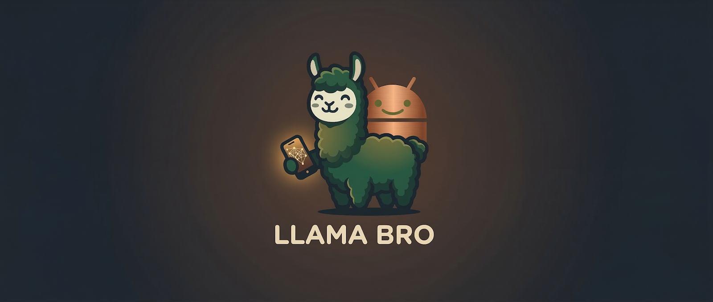

# Llama Bro

<p align="center">
  
</p>

Run GGUF models on Android with llama.cpp's own server core, in-process. The SDK exposes what `llama-server`
exposes (chat completions with templates, tool calls, reasoning, prompt cache, sampling, embeddings, rerank) through a
small Kotlin API built on coroutines and `Flow`, without an HTTP hop. It picks the right backend for the phone
(CPU, Adreno OpenCL, Hexagon NPU), fits the context to free memory, and downloads models from Hugging Face with
resume and verification.

> **Status:** pre-1.0. The core, backends, Hub and a complete demo chat app are built and tested; breadth (typed
> embeddings, rerank, completion) and publishing are next. Coordinates will be `io.github.whyisitworking:llamabro`.
> arm64-v8a, Android 10 (API 29) and up. Known issues are listed in [docs/research/history.md](docs/research/history.md#open-items).

## What is in this repository

| Folder | What it is |
|---|---|
| [`sdk/`](sdk/README.md) | The SDK: `llamabro` (core), `llamabro-hub` (Hugging Face downloads), `llamabro-hexagon` and `llamabro-opencl` (optional backends), `llamabro-testing` (a fake for your own tests), `acceptance/` (device test apps), `native/` (the C++ bridge and the llama.cpp submodule), `scripts/` (the checks) |
| [`demo/`](demo/README.md) | A chat app built on the SDK: find, download, resume and run models, think levels, image input, edit and regenerate, two layouts, a design system on Material 3 |
| [`docs/`](docs/README.md) | Architecture, decisions, testing, the demo's design, and the research record |
| [`research/`](research/README.md) | The experiments behind the design: scripts, method and results |
| `gradle/` | The Gradle wrapper and the shared version catalog |

## Five minutes

```kotlin
val llama = LlamaBro.getInstance(application)
val model = llama.loadModel(ModelSource.file(path))
val chat = model.conversation(system = "You are a helpful assistant.")
chat.send("Hello").collect()          // observe chat.messages and chat.reply
model.close()
```

[sdk/README.md](sdk/README.md) has a full chat screen, tools, the Hub, backends and error handling.

## Build

Open the repository root in Android Studio. It is one Gradle build over the SDK modules and the demo app; run
`:demo:app`. You need the Android SDK, NDK 29 and CMake 4.1.2, and the llama.cpp submodule:

```bash
git submodule update --init sdk/native/third_party/llama.cpp
```

The root build and `./gradlew -p sdk ...` (the SDK alone) share `build/` folders; do not run both at once.

## Verify

```bash
sdk/scripts/check.sh              # the SDK on the host; must print ALL PASS
sdk/scripts/check.sh --device     # plus tests on an attached device
demo/scripts/check.sh             # the demo app (add --device for the instrumented tests and journeys)
```

What each check proves, and what it needs, is in [docs/testing.md](docs/testing.md).

## Contributing

See [CONTRIBUTING.md](CONTRIBUTING.md). Design questions start in [docs/architecture.md](docs/architecture.md) and
[docs/decisions.md](docs/decisions.md); measured behaviour is in [docs/research/findings.md](docs/research/findings.md).

## License

Apache License 2.0, see [LICENSE](LICENSE). Built on [llama.cpp](https://github.com/ggml-org/llama.cpp) (MIT). The
demo bundles Source Serif 4 under the SIL Open Font License (`demo/designsystem/src/main/res/raw/source_serif_4_ofl.txt`).
